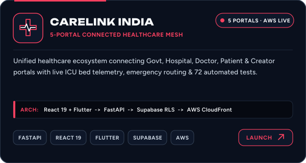
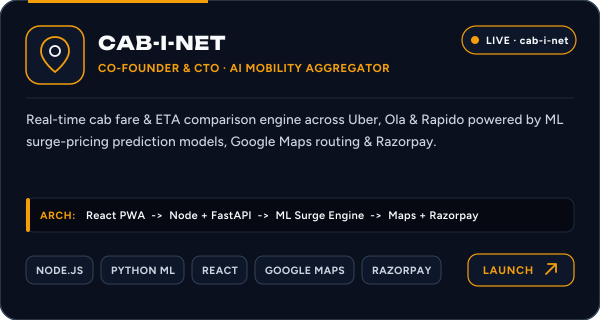
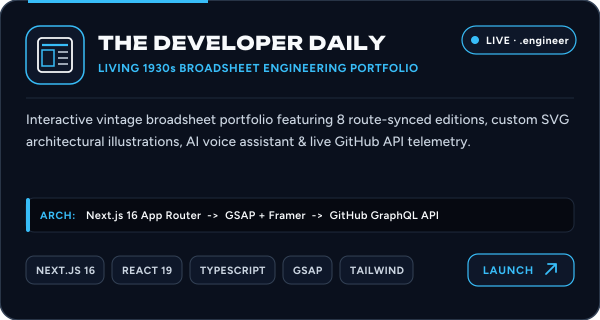
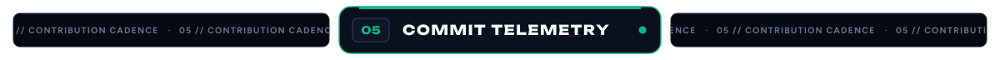
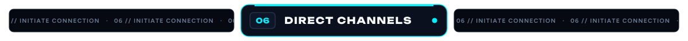
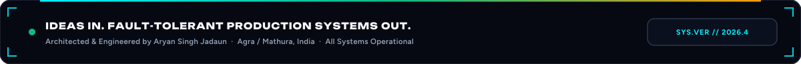

 

 

  
  

  
  

  
  

 

 

 

<picture>
  <source media="(prefers-color-scheme: dark)" srcset="https://raw.githubusercontent.com/jadaunaryansingh/jadaunaryansingh/output/github-contribution-grid-snake-dark.svg"/>
  <source media="(prefers-color-scheme: light)" srcset="https://raw.githubusercontent.com/jadaunaryansingh/jadaunaryansingh/output/github-contribution-grid-snake.svg"/>
  
</picture>

  

  
  
  

 

